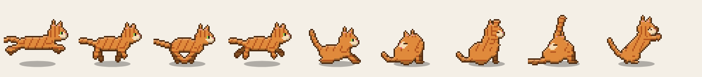
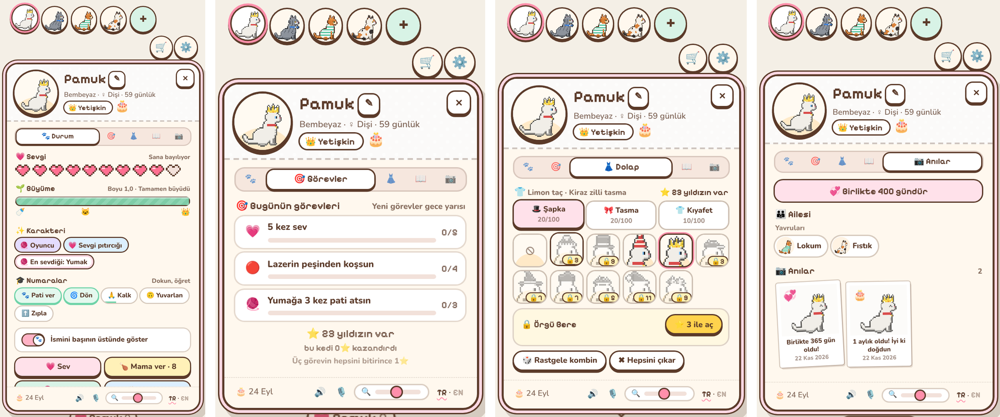
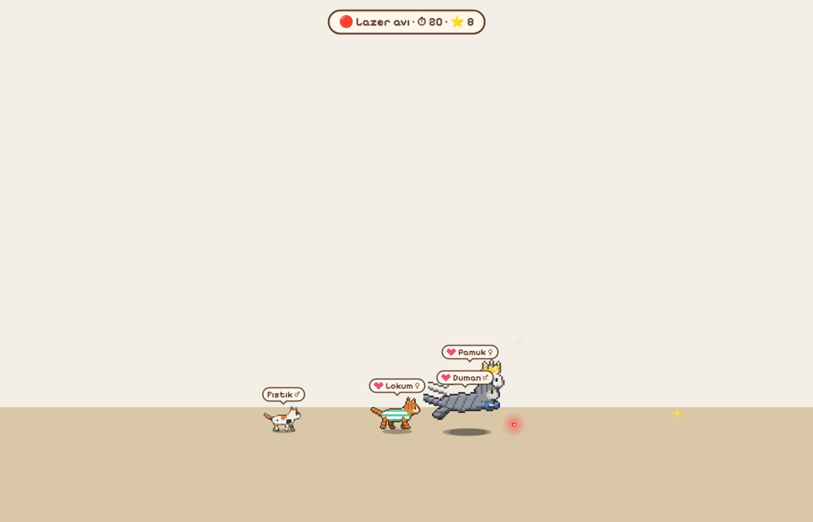
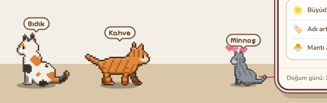
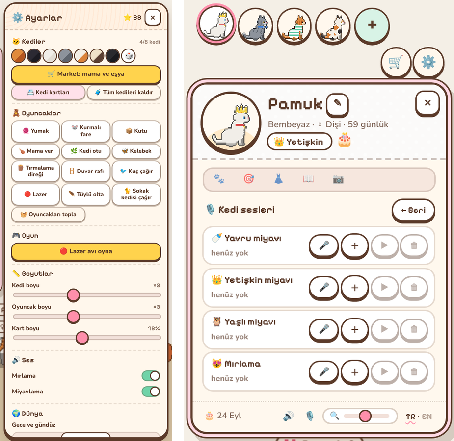

# Desktop Cat

Pixel cats that live on the bottom edge of your screen. They wander, groom, nap, stretch, roll over, sit in boxes, eat, and play with their toys — and you can play with them too.


## What they do

- **Wander** along the top of your taskbar, and stop to **boop noses** when two cats meet
- **Watch you** — bring the mouse pointer close and they turn their heads and follow it with their eyes
- **Groom** — lick a paw, wash behind the ears, twist round to lick a flank, or go full leg-in-the-air
- **Knead** — paws pressing in turn, eyes squeezed shut, before settling down
- **Nap** — curl into a loaf with little *z*'s floating up; wake with a big **stretch** and a **yawn**
- **Roll over** — belly up, paws kicking in the air
- **Zoomies** — once in a while, a sudden sprint from one side of the screen to the other, ending in a skidding stop. Now and then a second cat joins in and they race
- **Eat** — when you put food out, they trot over and tuck in, then groom
- **Sit in boxes** — of course. They duck down and peek out over the edge
- **Play** — chase, crouch with a bottom-wiggle, pounce, bat, stand up and swat
- **Day and night** — after 22:00 a little moon and twinkling stars come out and the cats get very sleepy; in the morning they stretch and yawn
- **Meow** — little meows when you pet them, when food appears, when they wake up: synthesised, or your own recordings (purring and meowing can be switched off separately, in ⚙️ Settings or with 🔊 on the card)
- **Play-fight** — two cats square up, swat and hop at each other, then one bolts and the other chases it until it flops over in surrender




## Toys

Only the yarn comes free; the rest are bought in the 🛒 market.


| Toy | |
| :-- | :-- |
| **Ball of yarn** | Throw it and they chase it. **Hold it** by the ball and they stand up to swat it and leap for it; pounce on it and it squirts away |
| **Wind-up mouse** | Scurries about until it winds down; the cats hunt it and send it flipping. Click it to wind it up again |
| **Cardboard box** | A cat will climb in and peek out. Drag the box around — passenger included. Click it to make the cat hop out |
| **Food bowl** | *Feed* puts a bowl out and fills it from your cupboard; pick it up and put it anywhere |
| **Laser pointer** | Turn it on and the red dot follows your mouse. Every cat on screen goes after it |
| **Feather wand** | A feather on a string at the end of a stick, held by your pointer. Swing it — they stand, swat and leap for it |
| **Butterfly** | Drifts about the room, rests on the floor or on a napping cat. The cats stalk and pounce; it always gets away |
| **Catnip** | From the market. Drop a pouch: each cat sniffs it, then rolls about in bliss — and often gets the zoomies after. Click it to freshen it up |
| **Wall shelf** | Put it anywhere on screen (drag it up and down too). Cats crouch, leap up onto it and lounge there |
| **Scratching post** | Cats stretch up against it and rake away, sisal fluff flying, the pom-pom swinging |


### Even more moves


They loaf with their paws tucked in, sploot flat on the floor, stand up like a meerkat to look around, spin after their own tail (kittens especially), bounce about when they're very happy, and now and then give you a **slow blink**, which is cat for "I love you".

## Every cat has a card

Right-click a cat to open its card, right above it. Drag it by its top or the avatars to put it anywhere (in the lower half of the screen it opens upwards); 📍 sends it back. The 🔍 slider at the bottom changes its size. The 🛒 market and ⚙️ settings sit on the card's top row and open right beside it.



- **Status** — name (🎲 suggests one), ♀ or ♂, love hearts, growing up, two personality traits and a favourite toy, tricks to teach (twelve good lessons each, at most six lessons a day, and kittens are too little to learn), quick actions
- **🎯 Tasks** — three little jobs a day per cat. Each pays coins; finishing all three pays a ⭐, and days in a row make a streak
- **👗 Wardrobe** — 300 things to wear (100 hats, 100 collars & bows, 100 outfits). Every design is locked and bought with ⭐ stars, then comes in all ten colours
- **📷 Memories** — the big moments kept as little polaroids, drawn as the cat looked that day, plus the family (parents, brothers and sisters, kittens) and how many days you've been together
- **📖 Diary** — everything they've been up to
- **🎙️ Cat sounds** — record your own meows (kitten, grown-up, old cat) and purrs with the microphone, or add sound files
- **📸 Photo** — saves a polaroid PNG of your cat, outfit and all

## Growing up takes real care

- A new cat arrives at height **0.1** and only grows while the app is running, it isn't **hungry** (a meal lasts eight hours) and it feels **loved** (love 30+): about **350 hours** of that to become a grown-up. Kitten 🍼 → young cat 🐱 → grown-up 👑 → after a year, a wise old cat 🦉 with a grey muzzle who takes life slower
- **Hearts fade** when nobody pays attention, faster when the cat is hungry. A lonely kitten or young cat may pack up and walk out (pet it on the way and it may stay); grown-ups stay, and a wise old cat only very rarely leaves
- **Boys and girls** — a kitten needs a mother and a father who are both happy and good friends; a litter is one, two or three kittens
- **Birthdays** at one week, 1, 2, 3 and 6 months and every year: cake, candle, confetti and a party hat

## 🛒 Market, coins and luck


| | |
| :-- | :-- |
| **🪙 Coins** | Earned slowly: tasks (1🪙 each, +3🪙 for all three), the laser hunt (1🪙 for every two stars caught, 25 a day at most) and simply using your computer (1🪙 every 15 active minutes, 20 a day at most). Spent on food, toys and furniture |
| **⭐ Stars** | Only from finishing all of a cat's tasks, or a laser-hunt score of 20+ (once a day). Spent on the wardrobe |
| **🧸 Toys** | Only the yarn is free. The wind-up mouse, box, butterfly, feather wand, scratching post, wall shelf and laser pointer are bought once in the market (the laser hunt needs the laser) |
| **🍗 Food** | Dry food (two meals for 10🪙), wet food, fish feasts, treats (they make teaching tricks easier), catnip and cat litter. The bowl only fills from your cupboard |
| **🎒 Inventory** | The cupboard (put food in the bowl, drop catnip, clean the litter box) and every piece of furniture: place it, put it away, repair it or sell it |
| **🎁 Luck** | A free gift chest once a day, and a wheel of luck for 25🪙. Mostly coins and food; furniture, a star or a new outfit only very, very rarely (the odds are listed under the wheel) |

### Home


Buy as many of each as you like and drag them anywhere. Cats loaf and roll on the **rug**, nibble the **plant**, curl up on the **cushion** or in the **cat bed**, crawl into the **cat house** to sleep out of sight, dash through the **tunnel**, climb the two-level **cat tree**, drink from the **water fountain**, watch the fish in the **aquarium** and use the **litter box** (keep it clean and love lasts longer; click it to clean it with litter from the cupboard). Rugs, cushions, beds, the tunnel and the cat tree wear out with use and time; worn things look faded, broken ones are ignored until you repair them. The cat house, fountain, litter box, aquarium and plant never wear out.

### Visitors


Now and then **birds** fly past; the cats stop to watch, and if one lands for a peck they stalk it (it always gets away). Once in a while a shy **stray** turns up: it keeps its distance and the cats arch their backs at it, but feed it three times and it moves in, ready for a name.

### Laser hunt



A 30-second mini game: lead the cats onto the twinkling stars with the laser.

## More

- **It knows you** — the cats come to say hello when you get back, say good morning, curl up next to your mouse when you've been away, and dream while they sleep. Very happy cats sleep belly-up
- **Real weather** — the sky over your desk follows the weather where you are (from [Open-Meteo](https://open-meteo.com), free, no account, checked once a day): rain, drizzle, snow, fog, drifting clouds, and storms with lightning, a low rumble of thunder and startled cats. On rainy days the cats get sleepy and the birds stay away. Your place is worked out roughly from your internet connection, or type a city in ⚙️ Settings; switch it off to follow the seasons instead
- **Seasons** — snow in winter, blossom in spring, fireflies on summer nights, falling leaves in autumn
- **Carry things** — hold the yarn by the ball, pick up the food bowl and put it anywhere (shake it and kibble spills)
- **Turkish and English** — the whole app




 


### ⚙️ Settings and cat sounds



Everything is saved on your computer and remembered next time.

## Playing with the cats

| | |
| :-- | :-- |
| **Click** a cat | Pet it — hearts and a soft purr (a sleeping cat wakes up and stretches) |
| **Drag** a cat | Pick it up by the scruff; let go and it lands on its feet |
| **Drag** a toy | Move the box, bowl or mouse; dangle the yarn, swing it and let go to throw it |
| **Right-click** a cat | Open its card |
| **⚙️ on the card** | Adopt a kitten, remove all cats, every toy, the laser hunt, sliders for **cat size**, **toy size** and **card size**, purring and meowing, day & night, seasons, birds, strays, kittens, language, start with your computer, hide, quit |
| **🛒 on the card** | The market |
| **Tray / menu-bar icon** | Open settings, hide or show the cats, quit (when there are no cats yet, ⚙️ and 🛒 also sit in the corner of the screen) |

Seven coats: ginger tabby, black, white, grey tabby, calico, siamese and tuxedo.

The window is transparent and click-through: your desktop works as normal, and the mouse is only caught when it is over a cat or a toy.

## Run it

You need [Node.js](https://nodejs.org) 18 or newer.

```bash
npm install
npm start
```

Build a stand-alone app — a portable `.exe` on Windows, a `.dmg` on macOS, an `AppImage` on Linux (build each on its own system):

```bash
npm run dist
```

On macOS the app isn't signed, so the first time, right-click it and choose **Open** (or *System Settings → Privacy & Security → Open Anyway*).

### Try it in a browser

Open `src/index.html` directly — it runs as a little demo room with buttons for every cat and toy.

## How it's drawn

No sprite sheets. Every frame, each cat is rasterised from simple shapes into a 48×42 material buffer, then lit — top edges catch the light, undersides and far legs fall into shadow — and outlined. Scaled up with nearest-neighbour, that gives the chunky "pixel 3D" look, and lets every coat pattern work in every pose. The toys are drawn the same way.

## License

MIT
