# Desktop Cat

Pixel cats that live along the bottom of your screen. They wander, groom, nap, stretch, sit in boxes, eat and play with their toys. You can play with them too: look after them, dress them up, grow a little garden, take them to the park and watch them grow up.


**Contents:** [The cats](#-the-cats) · [Every cat has a card](#-every-cat-has-a-card) · [Growing up and care](#-growing-up-and-care) · [The menu](#-the-menu) · [Home and garden](#-home-and-garden) · [The sky and visitors](#-the-sky-and-visitors) · [Guests, jobs and wishes](#-guests-jobs-and-wishes) · [Your progress](#-your-progress) · [Controls](#-controls) · [Run it](#-run-it)

---

## 🐱 The cats

Twenty-four coats: seventeen house cats and seven 👑 big cats (cheetah, puma, leopard, snow leopard, black panther, tiger and a maned lion). The big cats grow much bigger and are built differently: heavy legs, a deep chest and round ears, or long and leggy for the cheetah.

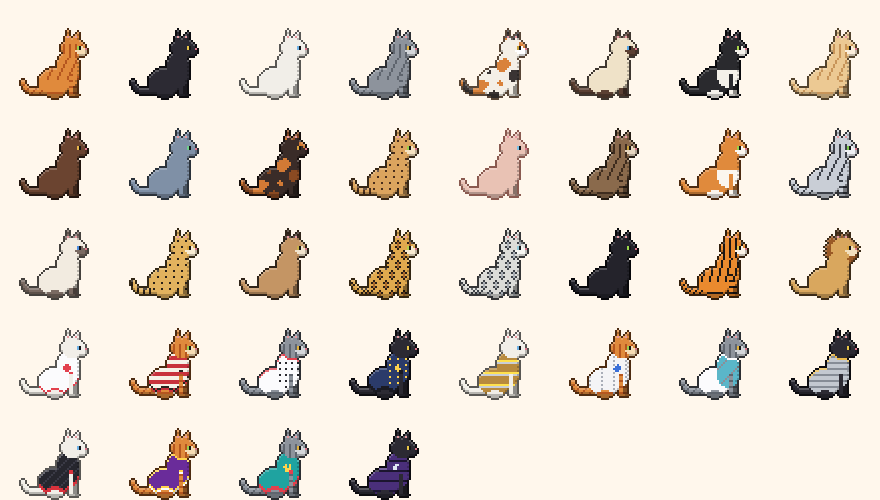


### What they do

- **Wander** along the taskbar and **boop noses** when two cats meet; **watch you** and follow the mouse pointer with their eyes
- **Groom** (paw, ears, flank, leg in the air), **knead**, **nap**, **stretch** and **yawn**
- **Zoomies** across the screen, sometimes as a race; **play-fights** that end in a chase
- **Eat** from the bowl, **sit in boxes** and peek out, **play** with every toy
- **Meow** and **purr** (synthesised, or your own recordings)
- **Day and night:** after 22:00 the moon comes out and the cats get sleepy

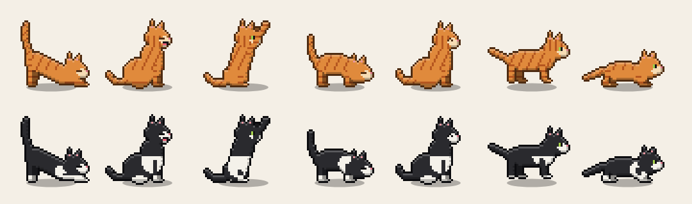

### Lots of ways to lie about

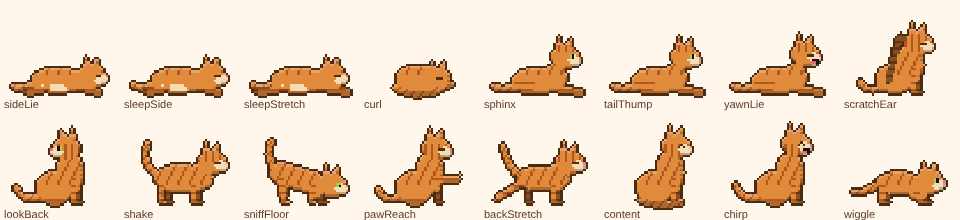

They flop over on their side, curl up like a doughnut with the tail over their nose, lie like a sphinx (thumping the tail, or with a big yawn), scratch an ear with a back foot, glance over their shoulder, give a full-body shake, sniff along the floor, stretch out a paw with the toes spread, stretch a back leg, sit very contented with the tail round their paws, chirp at you, and wiggle their bottom before pouncing on nothing. They sleep in four different ways too.

Older moves: loaf, sploot, meerkat, tail chase, happy bounce, slow blink ("I love you"), chattering at birds, nodding off, waving a paw, a play bow, and stalking low across the floor. Belly-up with waving paws is now a rarer treat.

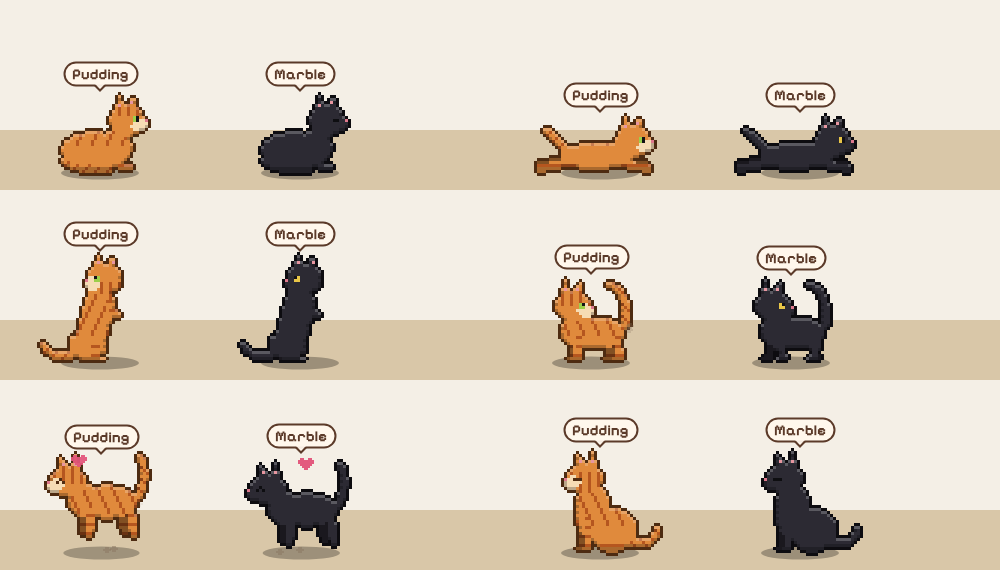

The big cats show off: the lion **roars** (the other cats flinch and the birds flee), the cheetah sprints the length of the screen.


## 🪪 Every cat has a card

Right-click a cat to open its card. Drag it anywhere; 📍 sends it back; 🔍 changes its size.


- **Status:** name, ♀/♂, love, growing up, personality, favourite toy, tricks to teach, genes, buffs, and care buttons (brush, bath, medicine, 🩺 vet)
- **🎯 Tasks:** three small jobs a day per cat, for coins and a ⭐
- **👗 Wardrobe:** 20 hats, 20 collars and 20 outfits in ten colours each, plus 12 costumes (nurse, pirate, chef, police, firefighter, astronaut, doctor, knight, ninja, royal robe, and our own superheroes, the Paw Hero and the Moon Claw)
- **📷 Memories**, **📖 Diary**, **🎙️ Cat sounds** and a **📸 polaroid** photo
- **💼 Work:** shows when the cat is away on a job (jobs come as offers, see below)


## 🌱 Growing up and care

- A new cat only grows while the app runs, it isn't hungry (a meal lasts 8 hours) and it feels loved. That takes about **350 hours**: kitten 🍼 → young cat 🐱 → grown-up 👑 → after a year, a wise old cat 🦉
- **Love fades** when nobody pays attention. A lonely kitten may walk out; grown-ups stay
- **Kittens** need a happy mother and father who are good friends; one to three in a litter
- **Birthdays** with cake, candles and confetti
- **Sickness and grooming:** hungry, lonely or dirty cats get ill. Medicine, a healthy meal or the vet cures them; brush them or bath them (a bathtub at home makes baths easier)


### 🧬 Genes

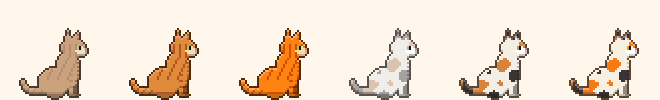

Every cat has four genes (shine, colour, pattern, eyes) and a grade from D to S. They drift very slowly with care: a loved, fed, clean, healthy cat improves, a neglected one fades. Great genes give a vivid, glossy coat; poor ones a pale, washed-out cat. Kittens take after their parents. Genes count in beauty contests, photo likes and modelling jobs.

## ☰ The menu

The card has a single **☰ Menu** button. It opens one panel with a strip of tabs on top, so everything is in one place:

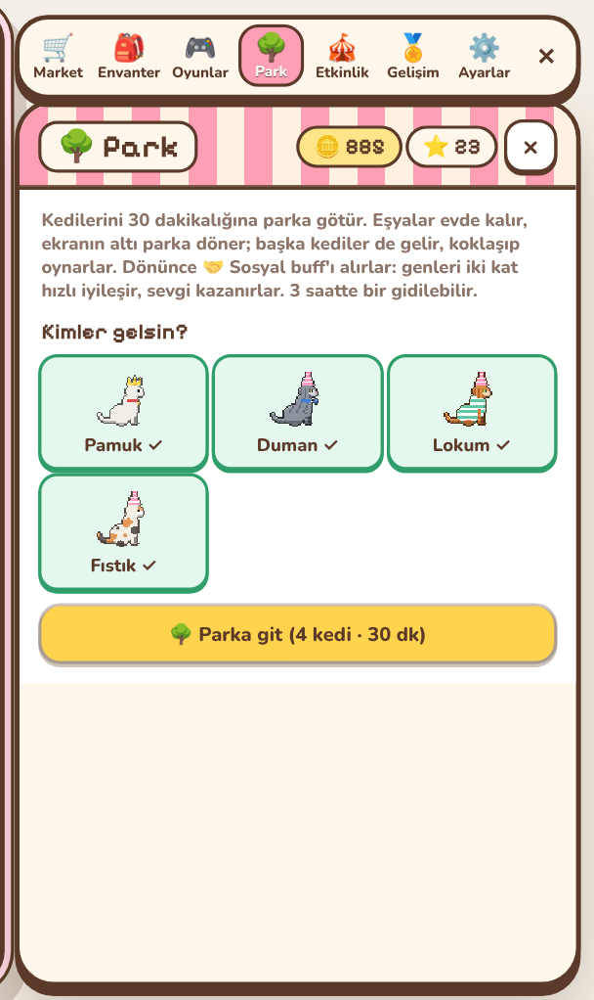

| Tab | |
| :-- | :-- |
| **🛒 Market** | Cats (unlock coats with ⭐; the first cat is free), food, toys, seeds, furniture and luck (a daily gift chest and a wheel) |
| **🎒 Inventory** | Your cupboard, toys and furniture as icons: take out, put away, repair, sell |
| **🎮 Games** | Scratch card, memory, whack-a-mouse and the laser hunt. Each costs coins and needs a 15-minute break before you play it again |
| **🌳 Park** | Take cats out for 30 minutes (see below) |
| **🎪 Events** | Photo feed, weekly contest, festivals |
| **🏅 Progress** | Your level, the skill tree, the album and achievements |
| **⚙️ Settings** | Sizes, sounds, day and night, weather, language, and more |

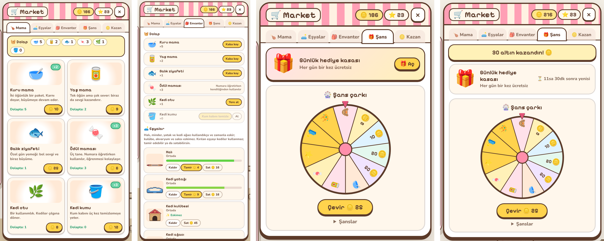

### Coins and stars

- **🪙 Coins** come in slowly over time: using your computer (1🪙 every 20 active minutes), tasks, wishes, guests, jobs, the garden, photos and contests. There are no daily caps; everything is paced by time instead.
- **⭐ Stars** come from finishing a cat's tasks, wish combos, contests, levelling up and rare luck. They unlock coats and wardrobe designs.
- Toys wear out with play; **tools** (brush, laser, feather wand, watering can) are bought once and last forever.
- A price you can't pay yet shows how many coins are missing.
- **🍱 Special meals** give buffs for a few hours: full, glow, grow, healthy, energy, calm, shiny, smart, lucky, sleepy, royal, and 🤝 social from the park.

### 🌳 The cat park

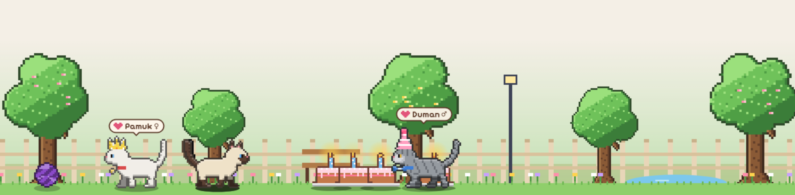

Take some cats out for 30 minutes. The bottom of the screen turns into a pixel park with trees, a bench, flowers and a pond. Strange cats wander in, sniff, boop and play. Back home your cats get the 🤝 Social buff: their genes improve twice as fast. Once every 3 hours.

### 🎪 Events

- **Photo feed:** post a cat's photo; it collects likes for a day, then you collect coins. One post every 2 hours.
- **Weekly contest:** beauty, tricks or love, a different one each week. When the week ends the results are announced on stage: the curtain opens, third, second and first place step up onto the podium, the winner gets a crown and the **Miss Cat** (or Mister Cat) title, and confetti rains down.
- **Festivals:** Winter Fair, Spring Fair, Summer Festival and Halloween, each with its own furniture and a daily gift.

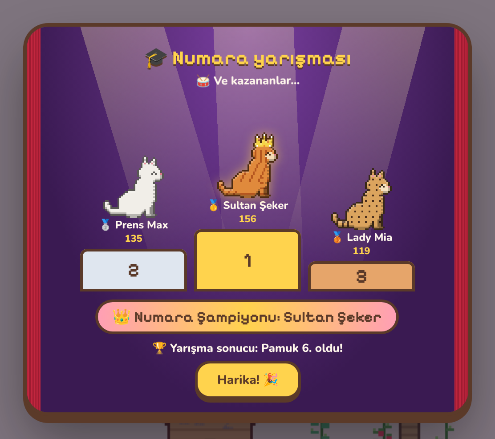

## 🏠 Home and garden

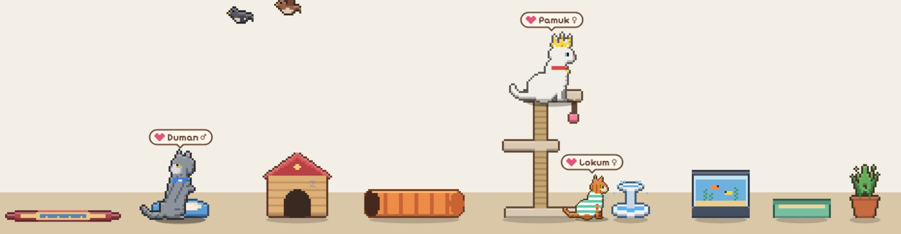

Over fifty pieces of furniture to buy and drag anywhere: beds, cushions, hammocks and sofas to nap on; a cat house, igloo, castle, teepee and pumpkin to hide in; trees, shelves and a giant tower to climb; a wheel, track ball, ball pit, piano and drum to play with; a TV, fan, clock, window, lava lamp and arcade machine to stare at; a fireplace, a fountain, a litter box, a bathtub and an automatic feeder. Some wear out with use and can be repaired.

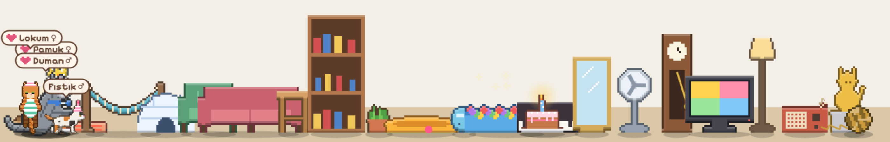


### 🪴 The garden on your desktop

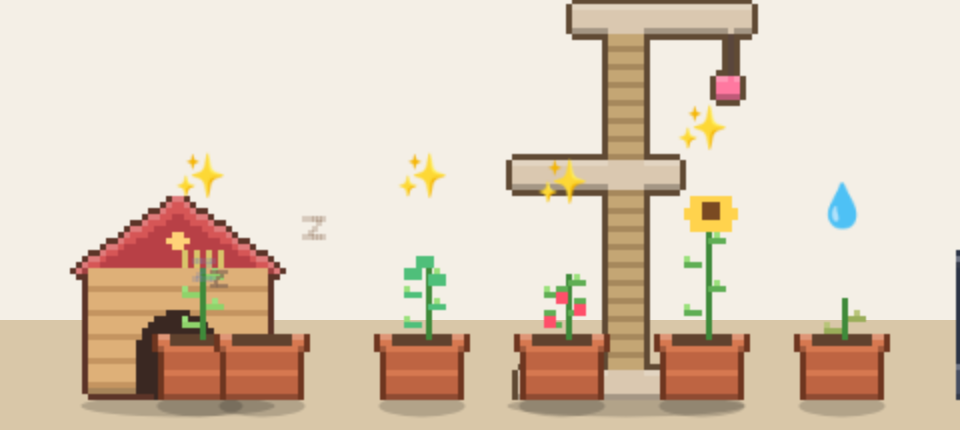 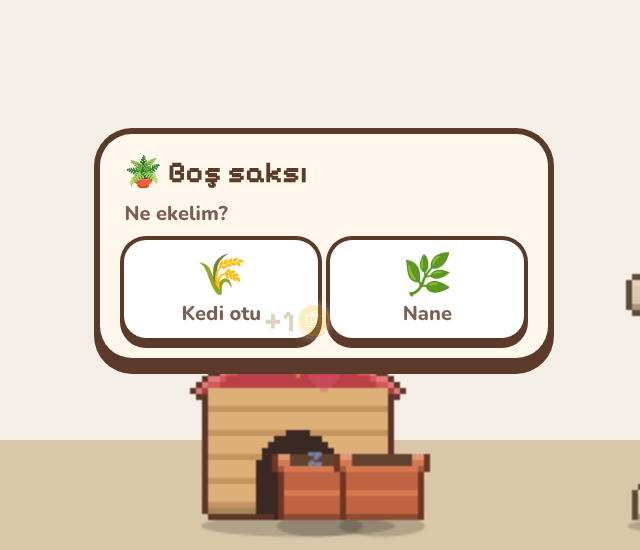

1. Buy a **pot** in the market's furniture section (as many as you like) and put it anywhere on the floor.
2. Buy **seeds** in the toys section. Each kind is bought **once**, then you can plant it forever: catnip (1 h), mint (3 h), strawberries (6 h), sunflowers (12 h).
3. **Click the pot** to plant, **water** it (with the watering can, 1🪙, unlimited water) and **harvest**.

Plants grow in real hours, even with the app closed, but only while watered (water lasts 6 hours; 12 hours dry and they wilt). You see them grow in the pot, with a 💧 when they're thirsty and a ✨ when they're ready. Harvests give catnip, coins, special meals and, rarely, a star.

## ☁️ The sky and visitors

- **Birds** fly over every 20–30 minutes, busier in spring and autumn, and about once an hour one lands on your desktop for a peck while the cats stalk it. Fourteen kinds: sparrows, pigeons, bluebirds, robins, canaries, cardinals, crows, magpies, a rare parrot and, at night, an owl; plus the seasonal ones: **swallows** in spring and summer, **storks** and **wild geese** migrating in a V in spring and autumn, and **mallards** flying in a line.

  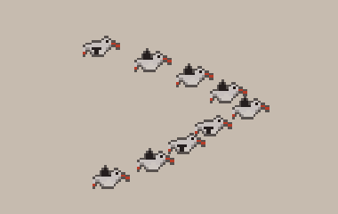

- **Clouds:** little kawaii clouds drift along the top of the screen, more on cloudy days. Some trail a rainbow; on rainy days they turn grey and grumpy and drip. On clear nights, a shooting star now and then.
- **Real weather:** rain, drizzle, snow, fog and thunderstorms follow the weather where you are (from [Open-Meteo](https://open-meteo.com), free, no account). Rainy days make the cats sleepy and keep the birds away.
- **Seasons:** snow in winter, blossom in spring, fireflies on summer nights, falling leaves in autumn.
- **Critters:** squirrels, butterflies and, at night, a hedgehog. A shy **stray** may turn up too: feed it three times and it moves in.


## 🧳 Guests, jobs and wishes

- **Guest cats:** like a little cat hotel. A neighbour asks you to look after their cat every 1–2 hours. Most stay an hour or two, a few up to a day, and pay by the hour: more for a happy, fed, clean cat.

  

- **💼 Job offers** come in at random for one of your free grown cats: clearing mice from the grocer's for 8 hours, scouting the street for an hour, scaring birds off the allotment, the cat café, the library, a cat food advert, the hospital, the fisherman, the factory night watch. Accept or decline. The cat walks off the screen and comes back (even if the app was closed) with coins, food or something special, then rests as long as the job took.
- **💭 Wishes:** every 20–45 minutes one of your cats wants something (a fish dinner, cuddles, a brush, a nap in a bed). Grant it in time for love, coins and XP; wishes in a row build a combo.
- **👋 Coming back:** a daily login streak, and a welcome card that sums up what happened while you were away.

## 🏅 Your progress

 

You level up too, slowly. Each level gives a skill point and coins, and opens room for more cats and pricier furniture.

- **Skill tree**, drawn as a real tree: 🏨 Hotel, 🍗 Care and 🛠️ Craft branches
- **Album:** every bird, critter, coat and piece of furniture you've seen; finished pages pay stars
- **Achievements:** goals like seeing the owl, a 10-wish combo or adopting a big cat

## 🎮 Controls

| | |
| :-- | :-- |
| **Click** a cat | Pet it: hearts and a soft purr |
| **Drag** a cat | Pick it up by the scruff; it lands on its feet |
| **Drag** a toy or furniture | Move it; dangle and throw the yarn |
| **Click** a pot | Plant, water, harvest |
| **Right-click** a cat | Open its card |
| **☰ Menu** on the card | Every panel, as tabs |
| **Tray / menu-bar icon** | Settings, hide or show the cats, quit |

The window is transparent and click-through: your desktop works as normal, and the mouse is only caught over a cat, a toy or a panel. Everything is saved on your computer. The whole app is in Turkish and English.

## ▶️ Run it

You need [Node.js](https://nodejs.org) 18 or newer.

```bash
npm install
npm start
```

Build a stand-alone app (a portable `.exe` on Windows, a `.dmg` on macOS, an `AppImage` on Linux; build each on its own system):

```bash
npm run dist
```

On macOS the app isn't signed, so the first time, right-click it and choose **Open**.

**Try it in a browser:** open `src/index.html` directly.

## 🎨 How it's drawn

No sprite sheets. Every frame, each cat is rasterised from simple shapes into a 48×42 material buffer, then lit (top edges catch the light, undersides and far legs fall into shadow) and outlined. Scaled up with nearest-neighbour, that gives the chunky "pixel 3D" look and lets every coat pattern work in every pose. Toys, furniture, birds and clouds are drawn the same way.

## License

MIT
