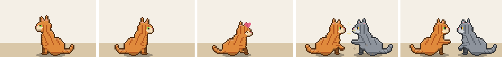
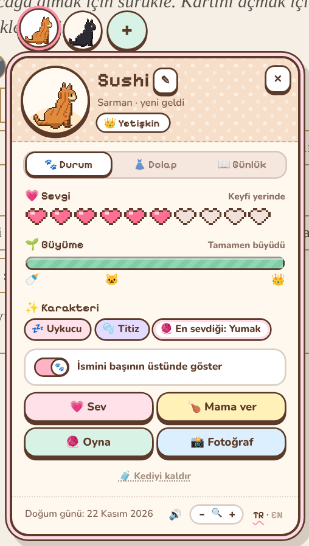
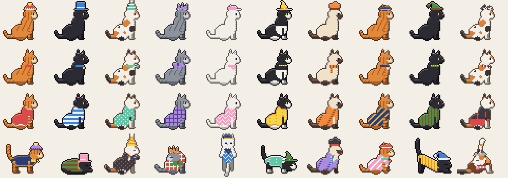
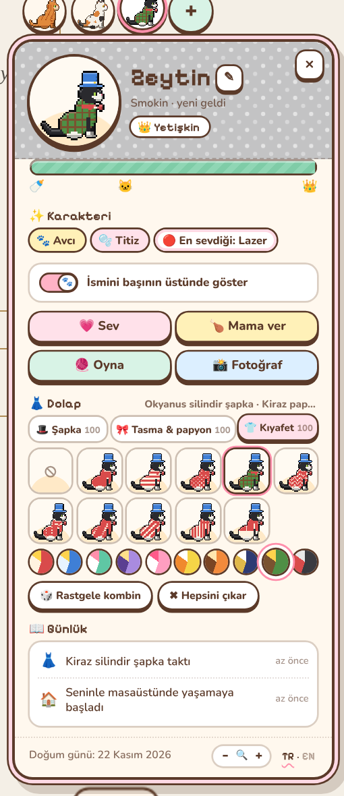

# Desktop Cat

Pixel cats that live on the bottom edge of your screen. They wander, groom, nap, stretch, roll over, sit in boxes, eat, and play with their toys — and you can play with them too.


## What they do

- **Wander** along the top of your taskbar, and stop to **boop noses** when two cats meet
- **Watch you** — bring the mouse pointer close and they turn their heads and follow it with their eyes
- **Groom** — lick a paw, wash behind the ears, twist round to lick a flank, or go full leg-in-the-air
- **Knead** — paws pressing in turn, eyes squeezed shut, before settling down
- **Nap** — curl into a loaf with little *z*'s floating up; wake with a big **stretch** and a **yawn**
- **Roll over** — belly up, paws kicking in the air
- **Zoomies** — once in a while, a sudden sprint from one side of the screen to the other, ending in a skidding stop. Now and then a second cat joins in and they race
- **Eat** — when you put food out, they trot over and tuck in, then groom
- **Sit in boxes** — of course. They duck down and peek out over the edge
- **Play** — chase, crouch with a bottom-wiggle, pounce, bat, stand up and swat
- **Day and night** — after 22:00 a little moon and twinkling stars come out and the cats get very sleepy; in the morning they stretch and yawn
- **Meow** — little synthesised meows when you pet them, when food appears, when they wake up (purring and meowing can be switched off separately, in ⚙️ Settings or with 🔊 on the card)
- **Play-fight** — two cats square up, swat and hop at each other, then one bolts and the other chases it until it flops over in surrender





## Toys

| Toy | |
| :-- | :-- |
| **Ball of yarn** | Throw it and they chase it. **Hold it** and it dangles on its string — they stand up to swat it and leap for it |
| **Wind-up mouse** | Scurries about until it winds down; the cats hunt it and send it flipping. Click it to wind it up again |
| **Cardboard box** | A cat will climb in and peek out. Drag the box around — passenger included. Click it to make the cat hop out |
| **Food bowl** | *Feed the cats* puts a bowl out; click the bowl to refill it |
| **Laser pointer** | Turn it on and the red dot follows your mouse. Every cat on screen goes after it |
| **Feather wand** | A feather on a string at the end of a stick, held by your pointer. Swing it — they stand, swat and leap for it |
| **Butterfly** | Drifts about the room, rests on the floor or on a napping cat. The cats stalk and pounce; it always gets away |
| **Catnip** | Drop a pouch: each cat sniffs it, then rolls about in bliss — and often gets the zoomies after. Click it to freshen it up |
| **Cat bed** | Sleepy cats walk over, knead it and curl up inside. Drag it with the sleeper in it |
| **Wall shelf** | Put it anywhere on screen (drag it up and down too). Cats crouch, leap up onto it and lounge there |
| **Scratching post** | Cats stretch up against it and rake away, sisal fluff flying, the pom-pom swinging |


### Even more moves


They loaf with their paws tucked in, sploot flat on the floor, stand up like a meerkat to look around, spin after their own tail (kittens especially), bounce about when they're very happy, and now and then give you a **slow blink**, which is cat for "I love you".

## Every cat has a card

Right-click a cat (or tap **Cat cards** in ⚙️ Settings) to open its card, right above the cat. Inside, three tabs keep it short: **Status** (love, growing up, personality, quick actions), **Wardrobe** and **Diary**. The 🔍 slider at the bottom makes the card smaller or bigger. Drag it by its top or by the avatars to put it anywhere: park it in the lower half of the screen and it opens upwards, with the avatars underneath. 📍 sends it back above the cat.



- **A name** — new cats arrive as kittens and ask to be named (🎲 suggests one). Click the name to change it any time
- **Name tag** — show the name in a little speech bubble above the cat's head, or keep it on the card only
- **Personality** — two random traits per cat, like *Playful*, *Sleepy*, *Cuddly*, *Curious*, *Foodie*, *Tidy*, *Rascal*, *Hunter* or *Lazy*, plus a favourite toy. They really change how the cat behaves: a sleepy cat naps more, a hunter goes after the mouse and the butterfly, a foodie lingers at the bowl
- **Growing up** — kittens start small and grow as you look after them: petting, feeding, playing, naps in the bed. Kitten 🍼 → young cat 🐱 → grown-up 👑
- **Love bar** — ten pixel hearts. Petting, feeding and playing (especially with their favourite toy) fill it up; it fades slowly if they're left alone for long
- **Diary** — what they've been up to: meals, naps, games, races, play-fights, growing up…
- **Wardrobe** — 300 things to wear: 100 hats, 100 collars & bows, 100 outfits (ten designs each, in ten colour schemes). They stay on in every pose, even asleep. 🎲 picks a surprise outfit
- **Photo** — 📸 saves a little polaroid of your cat, outfit and all, as a PNG
- **Birthdays** — at one week, then 1, 2, 3 and 6 months, then every year: a cake with a candle, confetti, a party hat and a diary entry
- **Daily tasks** — three little jobs a day for each cat (pet it five times, play with the yarn, take its photo…). Finish them for love, growing-up points and a ⭐; keep it up for a streak
- **Best friends and kittens** — cats who keep booping, racing and play-fighting become best friends. Two happy grown-up friends sometimes have a kitten that looks like one of them
- **Two currencies** — 🪙 coins buy food and furniture in the 🛒 market; ⭐ stars buy hats, collars and outfits on the cat card. Coins come from tasks (2🪙 each, +5🪙 for all three), the laser hunt (1🪙 per star caught, 40 a day at most) and simply using your computer (1🪙 every 10 active minutes, 30 a day at most). Stars only come from finishing all of a cat's tasks (1⭐) or a laser-hunt score of 20+ (once a day)
- **🛒 Market** — dry food (two meals for 10🪙), wet food, fish feasts, treats for teaching tricks, catnip, and furniture. The bowl only fills from your cupboard
- **Things wear out** — furniture wears a little with every use and every day; worn things look faded, broken things are ignored by the cats. Repair them or sell them under **My things**
- **Growing up takes real care** — a cat only grows while the app is running, it isn't hungry (a meal lasts eight hours) and it feels loved: about 250 hours of that to grow up
- **Wise old cats** — after a year a grown-up becomes a wise old cat with a grey muzzle who takes life a bit slower (and stays with you)
- **Memories** — the big moments (arriving, growing up, birthdays, kittens, tricks, days together, your photos) are kept as little polaroids in the card, drawn as the cat looked that day
- **Family** — parents, brothers and sisters and kittens, in the Memories tab
- **Tricks** — teach give-a-paw, spin, stand up, roll over and jump; a few good lessons and it knows them for good (and shows off now and then)
- **It knows you** — comes to say hello when you get back, says good morning, curls up next to your mouse when you've been away, and dreams while it sleeps
- **Seasons** — snow in winter, blossom in spring, fireflies on summer nights, falling leaves in autumn (can be switched off)
- **Real meows** — record them right in the app with the microphone (🎤), or add sound files (🎙️ on the card), separately for kittens, grown-ups and old cats; record your own cat or use free CC0 sounds. Without them the built-in synthesised meow plays
- **Home** — spend coins on rugs, potted plants, cushions, cat beds, a cat house they sleep inside, a two-level cat tree and an aquarium, as many of each as you like (in the 🛒 market). Cats loaf on the rug, nibble the plant, claim the cushion, climb the tree and watch the fish; drag them anywhere
- **Birds** — now and then birds fly past; the cats stop to watch, and if one lands for a peck, they stalk it (it always gets away)
- **Stray cats** — a shy stray turns up once in a while and keeps its distance. Feed it three times and it moves in, ready for a name
- **Laser hunt** — a 30-second mini game: lead the cats onto twinkling stars with the laser. Good scores and new records earn stars
- **Carry things** — hold the yarn by the ball itself, and pick up the food bowl and put it anywhere (shake it and kibble spills)
- **Boys and girls** — every cat is ♀ or ♂; a kitten needs a mother and a father, and a litter can be one, two or three kittens
- **Love needs looking after** — hearts fade when nobody pays attention. A lonely kitten or young cat may pack up and walk out (pet it on the way and it may stay); grown-ups stay, and a wise old cat only very rarely leaves
- Daily tasks are always on; kittens, birds, strays and seasons can be switched off in ⚙️ Settings
- **Saying goodbye** — remove a cat from its card (it asks first), or all of them at once from ⚙️ Settings
- **Turkish and English** — the whole app. Switch at the bottom of the card or under **Language** in ⚙️ Settings

Everything is saved on your computer and remembered next time.




  

<br clear="right">

## Playing with the cats

| | |
| :-- | :-- |
| **Click** a cat | Pet it — hearts and a soft purr (a sleeping cat wakes up and stretches) |
| **Drag** a cat | Pick it up by the scruff; let go and it lands on its feet |
| **Drag** a toy | Move the box, bowl or mouse; dangle the yarn, swing it and let go to throw it |
| **Right-click** a cat | Open its card |
| **⚙️ Settings (round button by the floor)** | Adopt a kitten, cat cards, remove all cats, every toy, the laser hunt, sliders for **cat size**, **toy size** and **card size**, purring and meowing, day & night, seasons, birds, strays, kittens, language, start with your computer, hide, quit |
| **Tray / menu-bar icon** | Open Settings, hide or show the cats, quit |

Seven coats: ginger tabby, black, white, grey tabby, calico, siamese and tuxedo.

The window is transparent and click-through: your desktop works as normal, and the mouse is only caught when it is over a cat or a toy.

## Run it

You need [Node.js](https://nodejs.org) 18 or newer.

```bash
npm install
npm start
```

Build a stand-alone app — a portable `.exe` on Windows, a `.dmg` on macOS, an `AppImage` on Linux (build each on its own system):

```bash
npm run dist
```

On macOS the app isn't signed, so the first time, right-click it and choose **Open** (or *System Settings → Privacy & Security → Open Anyway*).

### Try it in a browser

Open `src/index.html` directly — it runs as a little demo room with buttons for every cat and toy.

## How it's drawn

No sprite sheets. Every frame, each cat is rasterised from simple shapes into a 48×42 material buffer, then lit — top edges catch the light, undersides and far legs fall into shadow — and outlined. Scaled up with nearest-neighbour, that gives the chunky "pixel 3D" look, and lets every coat pattern work in every pose. The toys are drawn the same way.

## License

MIT
