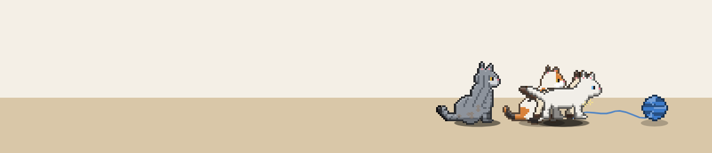

# Desktop Cat

Pixel cats that live on the bottom edge of your screen. They wander, groom themselves, curl up for naps, roll over onto their backs and chase a ball of yarn — and you can play with them.


## What they do

- **Walk & wander** along the top of your taskbar
- **Groom** — sit down and lick a paw
- **Nap** — curl into a loaf, breathing slowly, with little *z*'s floating up
- **Roll over** — belly up, paws kicking in the air
- **Play** — chase the yarn, crouch with a wiggle, pounce, and bat it around

## How to play with them

| | |
| :-- | :-- |
| **Click** a cat | Pet it — hearts and a soft purr (a sleeping cat wakes up) |
| **Drag** a cat | Pick it up by the scruff; let go and it lands on its feet |
| **Drag & throw** the yarn | The cats will race after it |
| **Tray icon** | Add a cat, throw yarn, make them bigger or smaller, hide them, start with your computer |

Seven coats: ginger tabby, black, white, grey tabby, calico, siamese and tuxedo.



The window is transparent and click-through: your desktop works as normal, and the mouse is only caught when it is over a cat or the yarn.

## Run it

You need [Node.js](https://nodejs.org) 18 or newer.

```bash
npm install
npm start
```

Build a stand-alone app (Windows portable `.exe`, macOS `.dmg` or Linux `AppImage`):

```bash
npm run dist
```

### Try it in a browser

Open `src/index.html` directly — it runs as a little demo room with buttons to add cats and throw yarn (double-click the floor for more yarn).

## How it's drawn

No sprite sheets. Every frame, each cat is rasterised from simple shapes into a 48×42 material buffer, then lit — top edges catch the light, undersides and far legs fall into shadow — and outlined. Scaled up with nearest-neighbour, that gives the chunky "pixel 3D" look, and lets every coat pattern work in every pose.

## License

MIT
