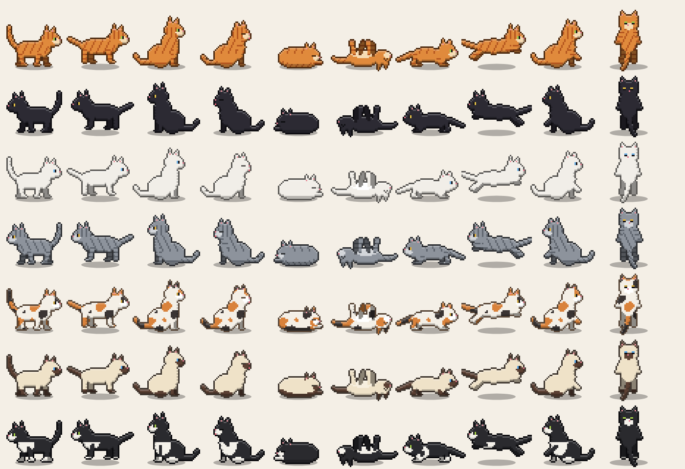
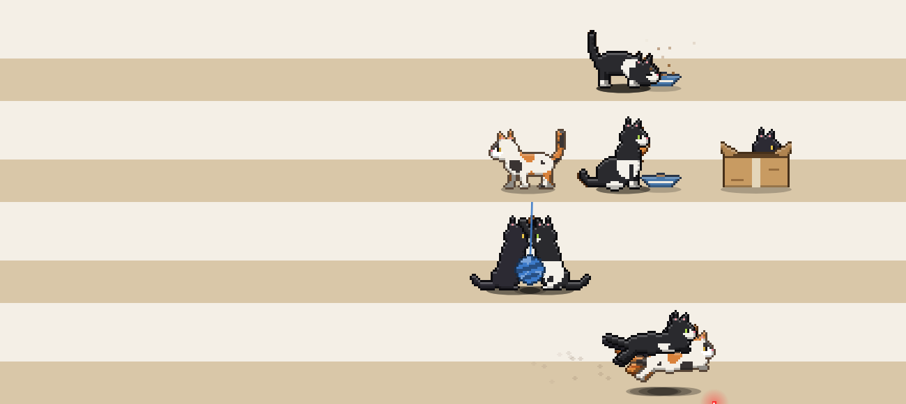
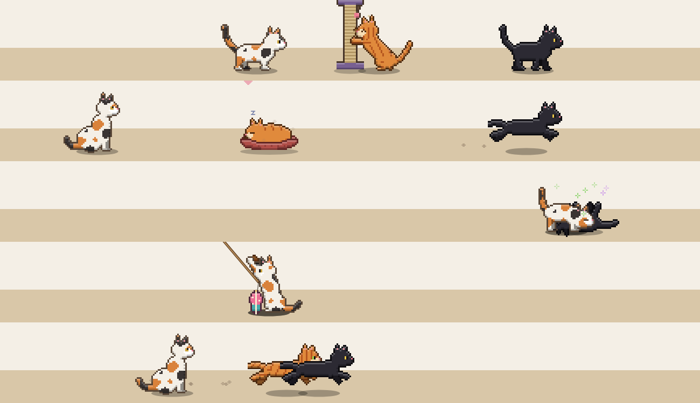

# Desktop Cat

Pixel cats that live on the bottom edge of your screen. They wander, groom, nap, stretch, roll over, sit in boxes, eat, and play with their toys — and you can play with them too.



## What they do

- **Wander** along the top of your taskbar, and stop to **boop noses** when two cats meet
- **Watch you** — bring the mouse pointer close and they turn their heads and follow it with their eyes
- **Groom** — lick a paw, wash behind the ears, twist round to lick a flank, or go full leg-in-the-air
- **Knead** — paws pressing in turn, eyes squeezed shut, before settling down
- **Nap** — curl into a loaf with little *z*'s floating up; wake with a big **stretch** and a **yawn**
- **Roll over** — belly up, paws kicking in the air
- **Zoomies** — a sudden full gallop from one side of the screen to the other, ending in a skidding stop. Sometimes a second cat joins in and they race
- **Eat** — when you put food out, they trot over and tuck in, then groom
- **Sit in boxes** — of course. They duck down and peek out over the edge
- **Play** — chase, crouch with a bottom-wiggle, pounce, bat, stand up and swat
- **Play-fight** — two cats square up, swat and hop at each other, then one bolts and the other chases it until it flops over in surrender


## Toys

| Toy | |
| :-- | :-- |
| **Ball of yarn** | Throw it and they chase it. **Hold it** and it dangles on its string — they stand up to swat it and leap for it |
| **Wind-up mouse** | Scurries about until it winds down; the cats hunt it and send it flipping. Click it to wind it up again |
| **Cardboard box** | A cat will climb in and peek out. Drag the box around — passenger included. Click it to make the cat hop out |
| **Food bowl** | *Feed the cats* puts a bowl out; click the bowl to refill it |
| **Laser pointer** | Turn it on and the red dot follows your mouse. Every cat on screen goes after it |
| **Feather wand** | A feather on a string at the end of a stick, held by your pointer. Swing it — they stand, swat and leap for it |
| **Butterfly** | Drifts about the room, rests on the floor or on a napping cat. The cats stalk and pounce; it always gets away |
| **Catnip** | Drop a pouch: each cat sniffs it, then rolls about in bliss — and often gets the zoomies after. Click it to freshen it up |
| **Cat bed** | Sleepy cats walk over, knead it and curl up inside. Drag it with the sleeper in it |
| **Scratching post** | Cats stretch up against it and rake away, sisal fluff flying, the pom-pom swinging |





## Playing with the cats

| | |
| :-- | :-- |
| **Click** a cat | Pet it — hearts and a soft purr (a sleeping cat wakes up and stretches) |
| **Drag** a cat | Pick it up by the scruff; let go and it lands on its feet |
| **Drag** a toy | Move the box, bowl or mouse; dangle the yarn, swing it and let go to throw it |
| **Tray / menu-bar icon** | Add a cat (seven coats), toys, feed them, laser pointer, **cat size** and **toy size** (each from tiny to large), hide them, start with your computer |

Seven coats: ginger tabby, black, white, grey tabby, calico, siamese and tuxedo.

The window is transparent and click-through: your desktop works as normal, and the mouse is only caught when it is over a cat or a toy.

## Run it

You need [Node.js](https://nodejs.org) 18 or newer.

```bash
npm install
npm start
```

Build a stand-alone app — a portable `.exe` on Windows, a `.dmg` on macOS, an `AppImage` on Linux (build each on its own system):

```bash
npm run dist
```

On macOS the app isn't signed, so the first time, right-click it and choose **Open** (or *System Settings → Privacy & Security → Open Anyway*).

### Try it in a browser

Open `src/index.html` directly — it runs as a little demo room with buttons for every cat and toy.

## How it's drawn

No sprite sheets. Every frame, each cat is rasterised from simple shapes into a 48×42 material buffer, then lit — top edges catch the light, undersides and far legs fall into shadow — and outlined. Scaled up with nearest-neighbour, that gives the chunky "pixel 3D" look, and lets every coat pattern work in every pose. The toys are drawn the same way.

## License

MIT
