# Desktop Cat

Pixel cats that live on the bottom edge of your screen. They wander, groom, nap, stretch, roll over, sit in boxes, eat, and play with their toys — and you can play with them too.


## What they do

- **Wander** along the top of your taskbar, and stop to **boop noses** when two cats meet
- **Watch you** — bring the mouse pointer close and they turn their heads and follow it with their eyes
- **Groom** — lick a paw, wash behind the ears, twist round to lick a flank, or go full leg-in-the-air
- **Knead** — paws pressing in turn, eyes squeezed shut, before settling down
- **Nap** — curl into a loaf with little *z*'s floating up; wake with a big **stretch** and a **yawn**
- **Roll over** — belly up, paws kicking in the air
- **Zoomies** — once in a while, a sudden sprint from one side of the screen to the other, ending in a skidding stop. Now and then a second cat joins in and they race
- **Eat** — when you put food out, they trot over and tuck in, then groom
- **Sit in boxes** — of course. They duck down and peek out over the edge
- **Play** — chase, crouch with a bottom-wiggle, pounce, bat, stand up and swat
- **Day and night** — after 22:00 a little moon and twinkling stars come out and the cats get very sleepy; in the morning they stretch and yawn
- **Meow** — little meows when you pet them, when food appears, when they wake up: synthesised, or your own recordings (purring and meowing can be switched off separately, in ⚙️ Settings or with 🔊 on the card)
- **Play-fight** — two cats square up, swat and hop at each other, then one bolts and the other chases it until it flops over in surrender


## Toys

Only the yarn comes free; the rest are bought in the 🛒 market.


| Toy | |
| :-- | :-- |
| **Ball of yarn** | Throw it and they chase it. **Hold it** by the ball and they stand up to swat it and leap for it; pounce on it and it squirts away |
| **Wind-up mouse** | Scurries about until it winds down; the cats hunt it and send it flipping. Click it to wind it up again |
| **Cardboard box** | A cat will climb in and peek out. Drag the box around — passenger included. Click it to make the cat hop out |
| **Food bowl** | *Feed* puts a bowl out and fills it from your cupboard; pick it up and put it anywhere |
| **Laser pointer** | Turn it on and the red dot follows your mouse. Every cat on screen goes after it |
| **Feather wand** | A feather on a string at the end of a stick, held by your pointer. Swing it — they stand, swat and leap for it |
| **Butterfly** | Drifts about the room, rests on the floor or on a napping cat. The cats stalk and pounce; it always gets away |
| **Catnip** | From the market. Drop a pouch: each cat sniffs it, then rolls about in bliss — and often gets the zoomies after. Click it to freshen it up |
| **Wall shelf** | Put it anywhere on screen (drag it up and down too). Cats crouch, leap up onto it and lounge there |
| **Scratching post** | Cats stretch up against it and rake away, sisal fluff flying, the pom-pom swinging |


### Even more moves


They loaf with their paws tucked in, sploot flat on the floor, stand up like a meerkat to look around, spin after their own tail (kittens especially), bounce about when they're very happy, and now and then give you a **slow blink**, which is cat for "I love you".

## Every cat has a card

Right-click a cat to open its card, right above it. Drag it by its top or the avatars to put it anywhere (in the lower half of the screen it opens upwards); 📍 sends it back. The 🔍 slider at the bottom changes its size. The 🛒 market and ⚙️ settings sit on the card's top row and open right beside it.


- **Status** — name (🎲 suggests one), ♀ or ♂, love hearts, growing up, two personality traits and a favourite toy, tricks to teach (twelve good lessons each, at most six lessons a day, and kittens are too little to learn), quick actions
- **🎯 Tasks** — three little jobs a day per cat. Each pays coins; finishing all three pays a ⭐, and days in a row make a streak
- **👗 Wardrobe** — 20 hats, 20 collars & accessories and 20 outfits, each in ten colours. Every design is locked and bought with ⭐ stars
- **📷 Memories** — the big moments kept as little polaroids, drawn as the cat looked that day, plus the family (parents, brothers and sisters, kittens) and how many days you've been together
- **📖 Diary** — everything they've been up to
- **🎙️ Cat sounds** — record your own meows (kitten, grown-up, old cat) and purrs with the microphone, or add sound files
- **📸 Photo** — saves a polaroid PNG of your cat, outfit and all

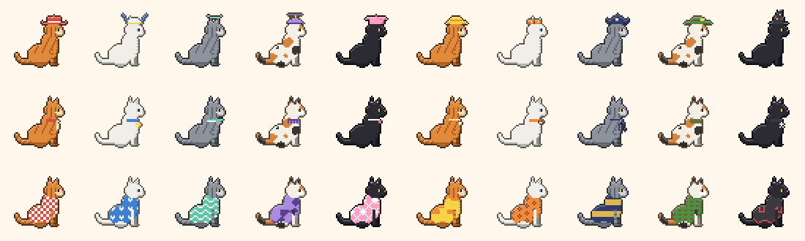

## Growing up takes real care

- A new cat arrives at height **0.1** and only grows while the app is running, it isn't **hungry** (a meal lasts eight hours) and it feels **loved** (love 30+): about **350 hours** of that to become a grown-up. Kitten 🍼 → young cat 🐱 → grown-up 👑 → after a year, a wise old cat 🦉 with a grey muzzle who takes life slower
- **Hearts fade** when nobody pays attention, faster when the cat is hungry. A lonely kitten or young cat may pack up and walk out (pet it on the way and it may stay); grown-ups stay, and a wise old cat only very rarely leaves
- **Boys and girls** — a kitten needs a mother and a father who are both happy and good friends; a litter is one, two or three kittens
- **Birthdays** at one week, 1, 2, 3 and 6 months and every year: cake, candle, confetti and a party hat

## 🛒 Market, coins and luck

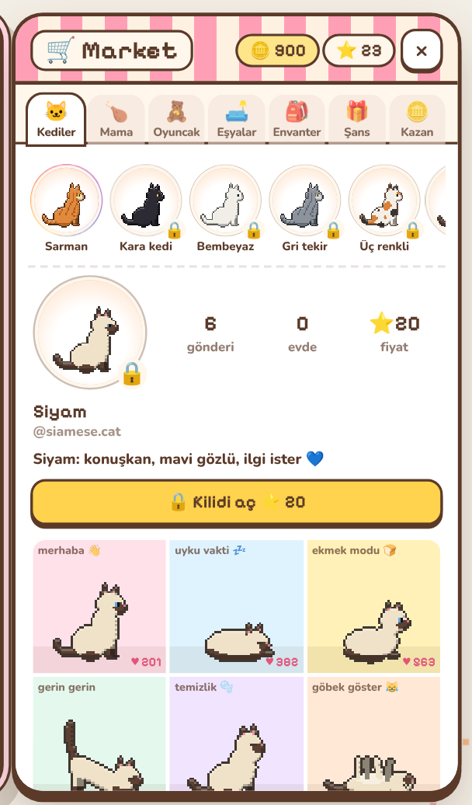

You start with one **ginger tabby**. Every other coat (black, white, grey tabby, tuxedo, calico, Siamese) is unlocked once with ⭐ stars in the market's **🐱 Cats** tab, then adopted for free. Each coat has its own little photo profile: a round picture, a bio and six photos of it sitting, napping, loafing, stretching, washing and lying belly up, so you can see a cat before you unlock it. Kittens born at home can still come in any coat.


| | |
| :-- | :-- |
| **🪙 Coins** | Earned slowly: tasks (1🪙 each, +3🪙 for all three), the laser hunt (1🪙 for every two stars caught, 25 a day at most) and simply using your computer (1🪙 every 15 active minutes, 20 a day at most). Spent on food, toys and furniture |
| **⭐ Stars** | Only from finishing all of a cat's tasks, or a laser-hunt score of 20+ (once a day). Spent on the wardrobe |
| **🧸 Toys** | Bought in the market's 🧸 Toys tab (your first yarn is free) and kept in the inventory, where you take them out, put them away or switch them on. Toys wear out with play and while left out; when one is worn to nothing it's gone and you buy a new one. Tools (the brush, laser pointer, feather wand and watering can) are bought once and last forever |
| **🍗 Food** | Dry food (two meals for 10🪙), wet food, fish feasts, treats (they make teaching tricks easier), catnip and cat litter. The bowl only fills from your cupboard |
| **🥣 Food bowl** | Kept in the inventory: take it out, then fill it from the cupboard (or click the bowl). An empty bowl says so with a little tag; clicking it never sends you shopping. Put it away when you're done; leftover food stays in it |
| **🎒 Inventory** | Its own panel (🎒 on the card), laid out as icons with a little wear bar: tap one to use it, take it out or put it away. The cupboard (put food in the bowl, drop catnip, clean the litter box) and every piece of furniture: place it, put it away, repair it or sell it |
| **🍱 Special meals** | 22 dishes (salmon, shrimp, chicken soup, caviar, birthday cake…), each giving a buff for a few hours: **full** (hunger lasts twice as long), **glow** (love fades slower), **grow**, **healthy** (cures sickness), **energy**, **calm**, **shiny** (love ×1.5), **smart** (tricks are easier), **lucky**, **sleepy** and **royal**. Active buffs show on the card |
| **🎁 Luck** | A free gift chest once a day, and a wheel of luck for 25🪙. Mostly coins and food; furniture, a star or a new outfit only very, very rarely (the odds are listed under the wheel) |

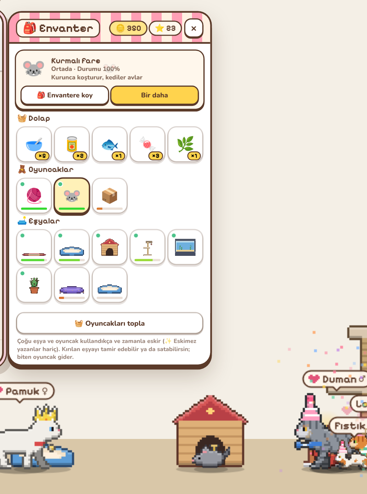

### Home

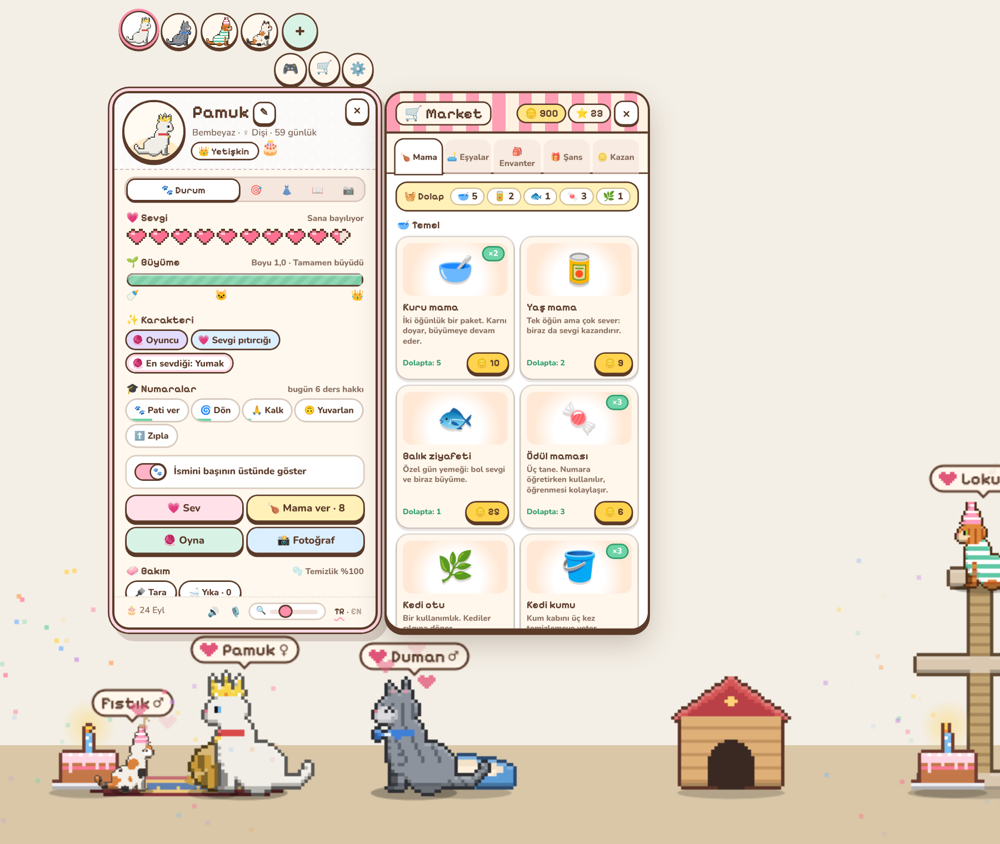

The 🎮 games, 🛒 market, 🎒 inventory and ⚙️ settings buttons sit on top of the card as round buttons, just like the cat portraits, and their panels open right beside it at the same size.


Buy as many of each as you like and drag them anywhere. Cats loaf and roll on the **rug**, nibble the **plant**, curl up on the **cushion** or in the **cat bed**, crawl into the **cat house** to sleep out of sight, dash through the **tunnel**, climb the two-level **cat tree**, drink from the **water fountain**, watch the fish in the **aquarium** and use the **litter box** (keep it clean and love lasts longer; click it to clean it with litter from the cupboard). Rugs, cushions, beds, the tunnel and the cat tree wear out with use and time; worn things look faded, broken ones are ignored until you repair them. The cat house, fountain, litter box, aquarium and plant never wear out.


Twenty more: they nap in the **basket**, **heat pad** (glows at night), **hammock**, **armchair** and **sofa**, hide in the **igloo**, climb the **stool** and **bookshelf**, nibble the **cat grass**, bat the **track ball**, **treat dispenser** and **ball pit**, walk on the **piano**, stare at the **mirror**, **fan**, **clock** pendulum and flickering **TV**, and doze by the **lamp** and the **radio** (music makes love fade a little slower). The **statue** is just for show.

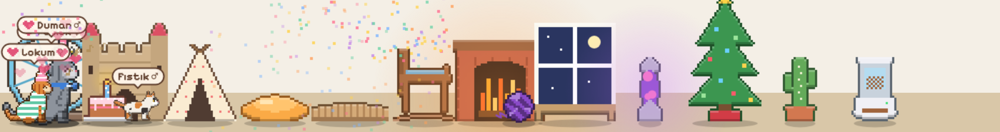

And twelve more: they run in the **cat wheel**, hide in the **cardboard castle** (and climb on top) and the **teepee**, nap on the **beanbag**, the **cardboard lounger** and the **rocking chair**, doze in front of the crackling **fireplace** (a warm home keeps love longer, more so in winter), watch the sky through the **window** (moon and stars at night), stare at the **lava lamp**, bat the baubles on the twinkling **Christmas tree** and scratch the **cactus**. The **automatic feeder** fills an empty bowl from your cupboard when someone's hungry, once every 8 hours.

### The sky

Every few minutes a little kawaii cloud drifts along the very top of the screen, like the birds: rarely on clear days, often when the real weather is cloudy, and grey and grumpy (dripping a few drops) when it rains. Some trail a rainbow or sit in front of one. On clear nights, once in a while, a shooting star streaks across.

Eight more: a **pumpkin house** to hide in, a **bathtub** full of bubbles and a **floor pillow** to nap on, a three-level **giant cat tower**, a **toy drum** to bat, an **arcade machine** with a game playing on its screen, a **globe** to stare at and a big **monstera**.

**Birds** now come in ten kinds: sparrows and pigeons most often, then bluebirds, robins, canaries, crows, magpies and cardinals, a rare parrot, and at night, very rarely, an owl.

### More cats, big cats and costumes


Seventeen coats now: the first seven plus cream, chocolate, Russian blue, tortoiseshell, Bengal, Sphynx, Maine coon, orange & white, silver tabby and Ragdoll. And seven 👑 big cats: cheetah, puma, leopard, snow leopard, black panther, tiger and a maned lion. They cost a lot more stars and grow a good deal bigger than a house cat. They are built differently too: the tiger, lion, leopards, puma and panther have heavy legs, a deep chest and small round ears; the cheetah is long, lean and leggy, with dark tear lines down its face.

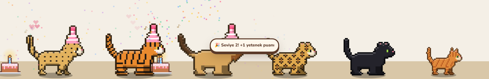

Your very first cat (the ginger tabby) is free; every adoption after that costs ⭐1. The wardrobe gains twelve costumes with their own colours: nurse, pirate, chef, police, firefighter, astronaut, doctor, knight, ninja, royal robe, and two superheroes of our own, the Paw Hero and the Moon Claw.

### 💭 Wishes

Every so often a cat wants something in particular: a fish dinner, its wind-up mouse, a few cuddles, a brush, a nap in a bed. A thought bubble shows it over the cat (and on its card). Grant it within 45 minutes for love, coins and XP; let it lapse and the cat sulks a little.

### 🌱 Garden, photos, contests and festivals

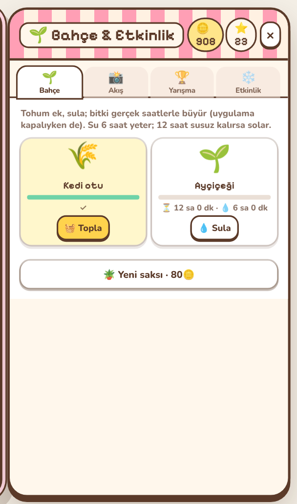

A new 🌱 panel on the card:
- **Garden:** buy a watering can (1🪙, unlimited water) and more pots in the market, then plant catnip (1 h), mint (3 h), strawberries (6 h) or sunflowers (12 h). They grow in real hours, even with the app closed, as long as they're watered (water lasts 6 hours; 12 hours dry and they wilt). Harvests give catnip, coins, special meals and, rarely, a star. One pot to start; more from the market.
- **Feed:** tap one of your cats to post its photo (or use 📸 on its card); it collects likes for a day (more for dressed-up, clean, happy cats and big cats); then you collect coins for them. Three posts a day.
- **Weekly contest:** beauty, tricks or love, a different one each week. Enter a cat (20🪙); it's judged when the week ends against six rivals. The top three win trophies, coins and stars.
- **Festivals:** a Winter Fair, Spring Fair, Summer Festival and Halloween, each with things you can only buy while it's on (a snowman, a gift box, tulips, a beach parasol, a ghost, a cauldron and more) and a daily gift.

### 💼 Jobs

Send a grown cat out for an hour's mouse hunt, a three-hour visit to the neighbours or an eight-hour trip to the tip. It walks off the screen and comes back (even if the app was closed) with coins, food, sometimes a piece of furniture or a star.

### 👋 Coming back

Every day you open the app adds to a login streak, with bigger gifts each day and a chest on day 7. If you've been away a while, a welcome card sums up what happened: guests who paid, cats back from work, a ripe garden, contest results.

### More life

- **Wish combos:** wishes granted one after another pay more and more; every fifth brings a star. Let one lapse and the combo breaks.
- **Big cats show off:** the lion roars (the other cats flinch and the birds flee), the cheetah sprints the length of the screen faster than anything, the others stretch and yawn hugely.
- **Visitors:** a squirrel dashes past now and then, butterflies flutter by, and at night a hedgehog trundles along. They have their own page in the album.
- **Achievements:** nineteen goals (look after 100 guests, a 10-wish combo, see the owl, adopt a big cat…), each with a reward.

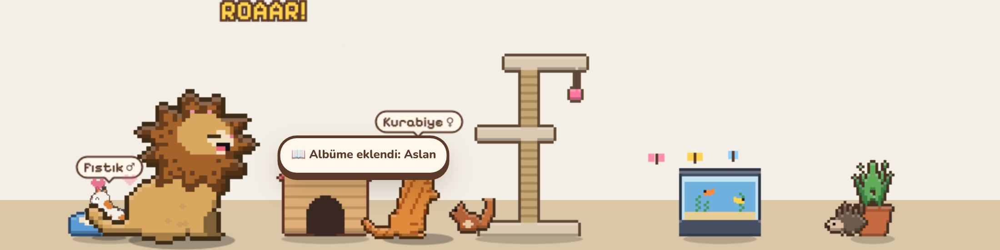

### 🌳 The cat park


From the 🌱 panel's Park tab, take some of your cats out for 30 minutes. Your things stay home and the bottom of the screen turns into a park, with a fence, trees, a bench, a lamp post, flowers and a pond. Strange cats wander in too, and the cats meet, sniff, boop and play. Back home they get the 🤝 Social buff (up to 6 hours): their genes improve twice as fast and they gain love. Once every 3 hours.

### 🧬 Genes


Every cat has four genes: shine, colour, pattern and eyes (0–100), and a grade from D to S shown on its card. Genes drift with care, very slowly (like growing up): a loved, fed, clean, healthy cat gains a gene point every couple of hours; a neglected one loses them, and the card shows which way it's going. Kittens of well-cared-for parents are born a little better, of neglected ones a little worse. Great genes give a vivid, glossy coat that glints now and then; poor ones a pale, washed-out cat with faded markings. Kittens take after their parents (with a little luck), strays usually have rough genes, and big cats come with good ones. Genes count in beauty contests and in photo likes, and a cat with good genes earns more modelling.

### Care: the vet and the bathtub

Call the 🩺 vet from a cat's card (25🪙 for a check-up, 45🪙 if it's ill): it cures illness, tidies the cat up and keeps it healthy for 6 hours. With a bathtub at home, baths need no shampoo (the tub has to dry for 3 hours between baths) and cats mind them less.

### More jobs, offered

Besides the jobs you pick on the card, job offers come in every 1–3 hours for one of your free cats: clear the mice out of the grocer's storeroom for 8 hours, scout the street for an hour, scare the birds off the allotment, greet customers at the cat café, guard the library, pose for a cat food advert (better genes, better pay), cheer up children at the hospital, help the fisherman, or keep the factory's night watch. They pay better than the jobs you choose yourself.

### New moves

Cats now chatter at birds with their jaws going, nod off sitting up, wave a paw at you, drop into a play bow before tearing off on a zoomie, and stalk low across the floor before pouncing.

### 🏅 Your progress

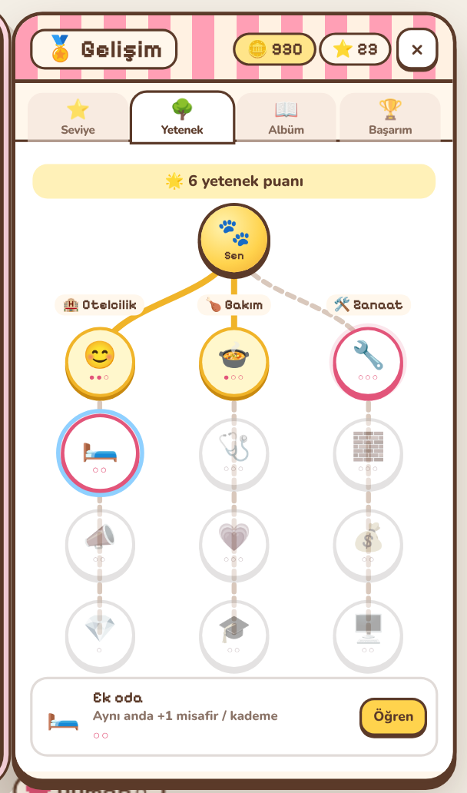 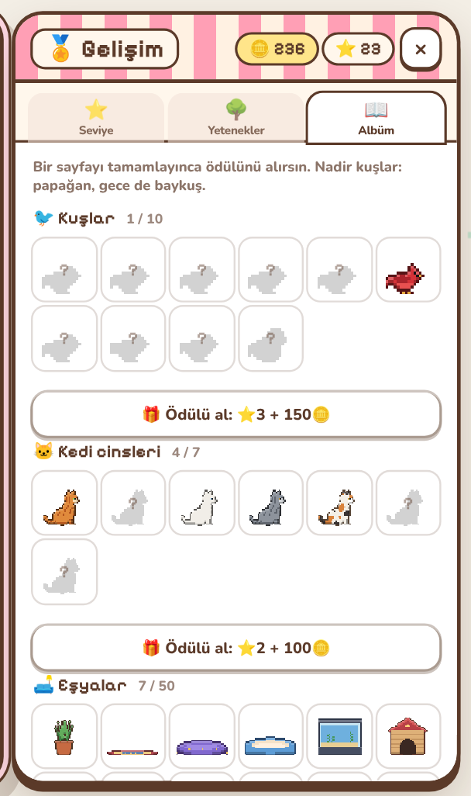

You grow too. Petting, feeding, playing, tasks, tricks, guests and mini games give you XP, and levelling up is slow on purpose (80 × level^1.8 XP for the next one). Every level gives a skill point and coins (and a star every 5 levels), and it opens more: room for more cats (4 at first, 8 at level 13) and pricier furniture in the market.

- **Skill tree:** drawn as a real tree, with you at the root and three branches growing down; the lines light up gold as you learn. 🏨 Hotel (better guest pay, more guest rooms, a better name, VIP guests), 🍗 Care (cats stay full longer, fall ill less, love more, learn tricks easier) and 🛠️ Craft (cheaper repairs, things wear slower, better selling prices, more coins from computer time). Deeper skills open as you spend points in a branch.
- **Album:** every bird you've seen, every cat coat you've had and every piece of furniture you've owned. New entries give XP; a finished page gives stars and coins. The parrot is rare, and the owl only comes at night.

### 🧳 Guest cats

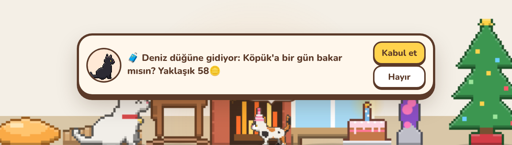

Like a little cat hotel: every 1–2 hours (at most 7 a day) a neighbour asks you to look after their cat. Most stay an hour or two; now and then one stays longer, at most a day, and pays well. The pay goes by the hour. You have one guest room to start with (the Spare room skill adds more). When the owner comes back they pay you: more for a happy, fed, clean cat, more for a home full of things it can use, and more as your sitter rating grows. If the guest gets ill, goes hungry for too long or is left alone and unloved, they take it back and pay nothing, and your rating drops.

### Visitors

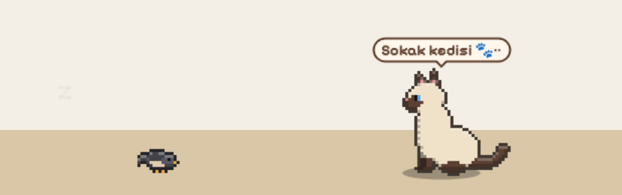

Now and then **birds** fly past; the cats stop to watch, and if one lands for a peck they stalk it (it always gets away). Once in a while a shy **stray** turns up: it keeps its distance and the cats arch their backs at it, but feed it three times and it moves in, ready for a name.

### Care: sickness and grooming

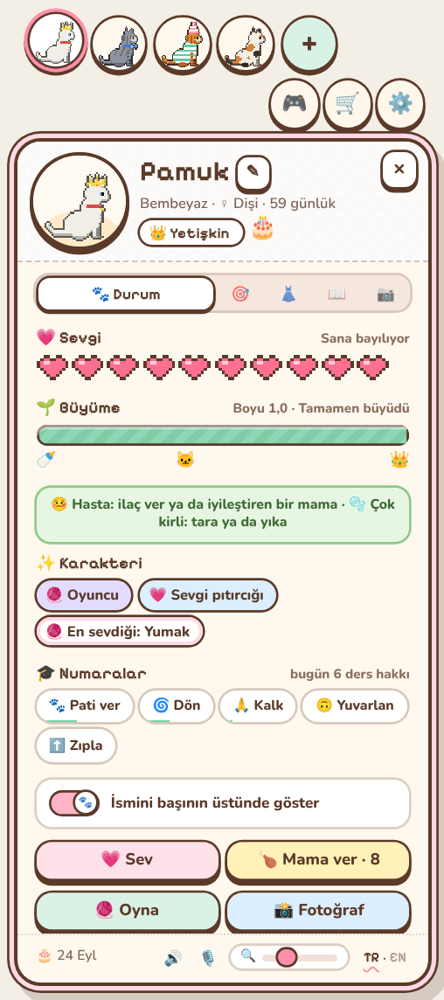

Hungry, lonely or dirty cats can get **sick**: they grumble, play less and love fades faster. Medicine (or a healthy meal) cures them. Cats also get **grubby** with time, play and fights; brush them (needs the brush from the market) or give them a bath with shampoo. Clean cats earn love faster.

### 🎮 Mini games

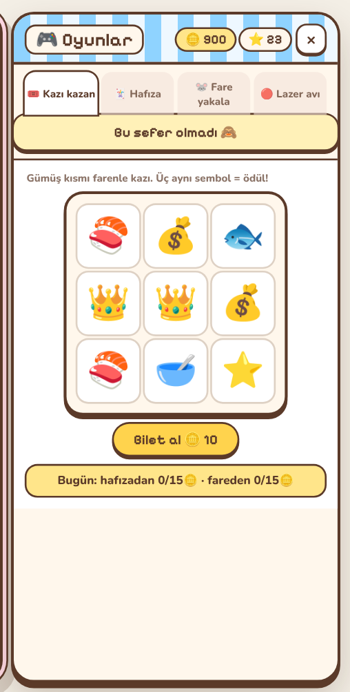

Nothing is free: every game costs coins to play, and most of the time you win back less than you put in.

- **Scratch card:** 25🪙 a ticket. Scratch the silver with your mouse; three matching symbols win coins (up to 250), food, a special meal or (very rarely) a star. Most tickets lose
- **Memory:** 8🪙 to play. Match the pairs in 60 seconds; finish in few moves for up to 16🪙 (15🪙 a day at most)
- **Whack-a-mouse:** 6🪙 to play. 25 seconds of mice popping out of holes, 1🪙 for every two (15🪙 a day at most)
- **Laser hunt:** 10🪙 to play (needs the laser). Lead the cats onto the twinkling stars


## More

- **It knows you** — the cats come to say hello when you get back, say good morning, curl up next to your mouse when you've been away, and dream while they sleep. Very happy cats sleep belly-up
- **Real weather** — the sky over your desk follows the weather where you are (from [Open-Meteo](https://open-meteo.com), free, no account, checked once a day): rain, drizzle, snow, fog, drifting clouds, and storms with lightning, a low rumble of thunder and startled cats. On rainy days the cats get sleepy and the birds stay away. Your place is worked out roughly from your internet connection, or type a city in ⚙️ Settings; switch it off to follow the seasons instead
- **Seasons** — snow in winter, blossom in spring, fireflies on summer nights, falling leaves in autumn
- **Carry things** — hold the yarn by the ball, pick up the food bowl and put it anywhere (shake it and kibble spills)
- **Turkish and English** — the whole app


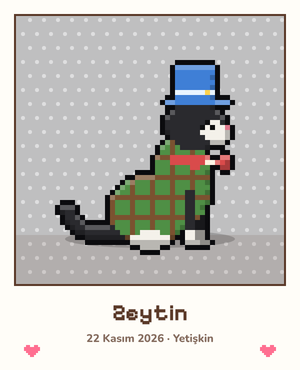 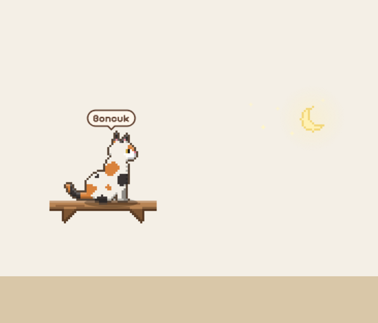

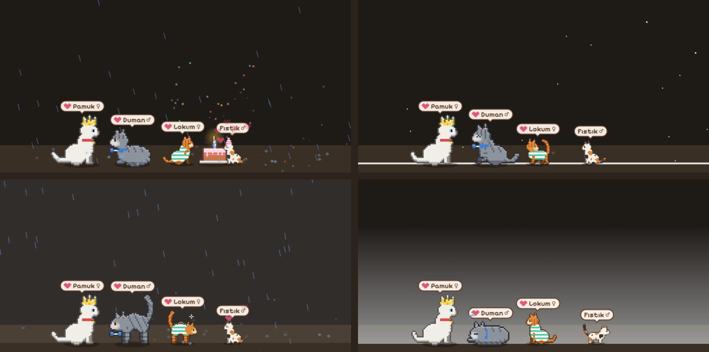

### ⚙️ Settings and cat sounds


Everything is saved on your computer and remembered next time.

## Playing with the cats

| | |
| :-- | :-- |
| **Click** a cat | Pet it — hearts and a soft purr (a sleeping cat wakes up and stretches) |
| **Drag** a cat | Pick it up by the scruff; let go and it lands on its feet |
| **Drag** a toy | Move the box, bowl or mouse; dangle the yarn, swing it and let go to throw it |
| **Right-click** a cat | Open its card |
| **⚙️ on the card** | Adopt a kitten, remove all cats, every toy, the laser hunt, sliders for **cat size**, **toy size** and **card size**, purring and meowing, day & night, seasons, birds, strays, kittens, language, start with your computer, hide, quit |
| **🛒 on the card** | The market |
| **Tray / menu-bar icon** | Open settings, hide or show the cats, quit (when there are no cats yet, ⚙️ and 🛒 also sit in the corner of the screen) |

Seven coats: ginger tabby, black, white, grey tabby, calico, siamese and tuxedo.

The window is transparent and click-through: your desktop works as normal, and the mouse is only caught when it is over a cat or a toy.

## Run it

You need [Node.js](https://nodejs.org) 18 or newer.

```bash
npm install
npm start
```

Build a stand-alone app — a portable `.exe` on Windows, a `.dmg` on macOS, an `AppImage` on Linux (build each on its own system):

```bash
npm run dist
```

On macOS the app isn't signed, so the first time, right-click it and choose **Open** (or *System Settings → Privacy & Security → Open Anyway*).

### Try it in a browser

Open `src/index.html` directly — it runs as a little demo room with buttons for every cat and toy.

## How it's drawn

No sprite sheets. Every frame, each cat is rasterised from simple shapes into a 48×42 material buffer, then lit — top edges catch the light, undersides and far legs fall into shadow — and outlined. Scaled up with nearest-neighbour, that gives the chunky "pixel 3D" look, and lets every coat pattern work in every pose. The toys are drawn the same way.

## License

MIT
